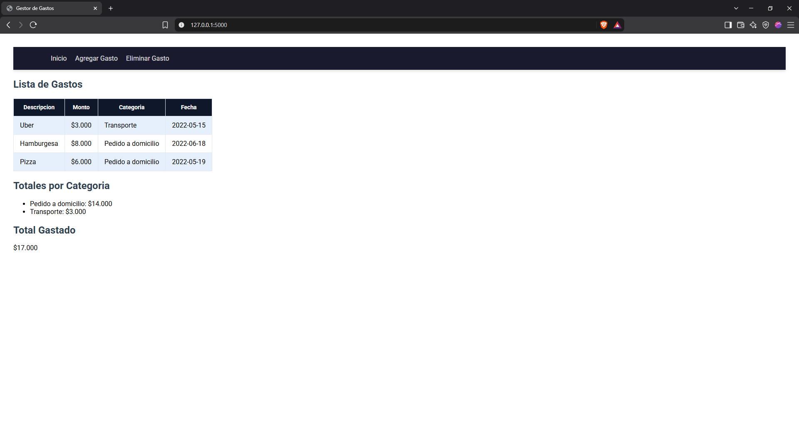
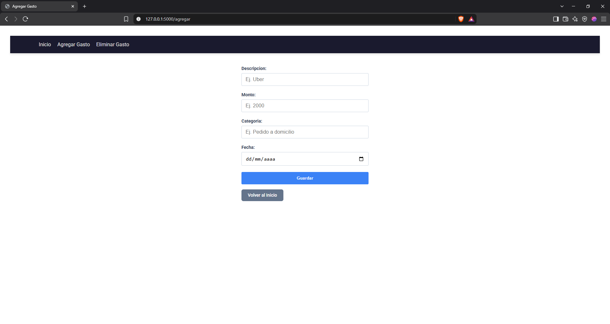
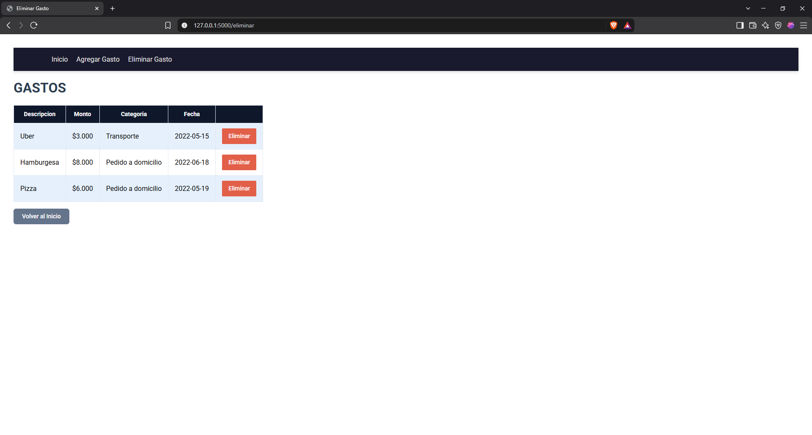

# Gestor de Gastos

Aplicación web desarrollada como proyecto personal de aprendizaje, cuyo objetivo es permitir la gestión y el seguimiento de gastos personales de manera sencilla.

La aplicación permite registrar nuevos gastos, consultar los gastos existentes y eliminar aquellos que ya no se desean conservar.

## Funcionalidades

La aplicación cuenta con las siguientes funcionalidades:

- **Visualización de gastos:** Muestra todos los gastos registrados en una tabla con su descripción, monto, categoría y fecha.
- **Resumen de gastos:** Permite visualizar el importe total de los gastos y los totales acumulados por cada categoría.
- **Agregar gastos:** Permite registrar nuevos gastos mediante un formulario.
- **Eliminar gastos:** Permite eliminar individualmente cualquier gasto registrado.

## Tecnologías utilizadas

Para el desarrollo de este proyecto se utilizaron las siguientes tecnologías:


- **Python:** Lenguaje de programación utilizado para la lógica de la aplicación.
- **Flask:** Framework utilizado para desarrollar el servidor y gestionar las rutas.
- **HTML5:** Estructura y contenido de las páginas web.
- **CSS3:** Diseño y estilos de la interfaz.
- **SQLite:** Base de datos utilizada para almacenar los gastos.

## Capturas de pantalla

Capturas de las diferentes secciones de la aplicación.

- Página principal



Formulario para agregar gastos



Página para eliminar gastos



## Instalación y ejecución

Para ejecutar este proyecto de manera local, es necesario tener instalado Python.

### 1. Clonar el repositorio

Clonar el repositorio desde GitHub:

```bash
git clone URL_DEL_REPOSITORIO
```

Ingresar a la carpeta del proyecto:

```bash
cd NOMBRE_DEL_PROYECTO
```

### 3. Instalar las dependencias

Instalar las dependencias necesarias para ejecutar la aplicación:

```bash
pip install -r requirements.txt
```

### 4. Ejecutar la aplicación

Iniciar el servidor de desarrollo de Flask:

```bash
python app.py
```

Una vez iniciado el servidor, abrir el navegador y acceder a:

```text
http://127.0.0.1:5000
```

¡Listo! La aplicación estará funcionando localmente.

### 5. Base de datos (SQLITE)

Una vez iniciada la aplicación, se creara la base de datos vacía llamada "gastos.db"

## Estructura del proyecto

La estructura general del proyecto se organiza de la siguiente manera:

```text
gestor_gastos_web/
│
├── templates/          # Plantillas HTML
├── static/             # Archivos CSS y recursos estáticos
├── app.py              # Aplicación principal de Flask
├── requirements.txt    # Dependencias del proyecto
├── README.md           # Documentación del proyecto
└── database.py         # Logica de la Base de datos SQLite
```

## Objetivo del proyecto

Este proyecto fue desarrollado con fines educativos y de aprendizaje, con el propósito de poner en práctica conocimientos de Python, Flask, desarrollo web y manejo de bases de datos SQLite.

## Autor

Desarrollado por **Enzo**.

Proyecto personal realizado con fines de aprendizaje.